<p align="center"></p>

# PMcp

> **Тестовая версия, ещё в разработке.** Это эксперимент для того, чтобы поиграть и побаловаться. Что-то может не работать, конфиг и команды ещё могут поменяться. Местами встретятся странные и неоптимальные игровые решения: ИИ может выдать неудачные роли, сочинить нелепый сюжет или объявить тревогу не к месту. начни с `dry_run: true` и тестового сервера

PMcp превращает сервер SCP: Secret Laboratory в площадку для ИИ. Через него нейросеть может смотреть, что происходит на сервере, отвечать на вопросы админов и даже вести раунд как живой ивент-мейкер: придумать сюжет, раздать роли, объявлять тревоги голосом CASSIE, моргать светом, блокировать двери и реагировать на то, что творят игроки

## Что внутри

**MCP-сервер.** к нему можно подключить Claude Code, Claude Desktop, ollmcp и любой другой MCP-клиент. По умолчанию ИИ только смотрит: статус сервера, игроки, последние события, карта. Если хочется, чтобы он ещё и действовал, это включается в конфиге, и каждое действие сначала подтверждает админ

**ИИ-агент.** Плагин сам ходит в любую OpenAI-совместимую модель по API-ключу: OpenAI, DeepSeek, ProxyAPI, локальная Ollama

**Дирижёр раунда.** ИИ пишет план раунда, плагин его исполняет, а ИИ подключается снова только тогда, когда в раунде происходит что-то важное

## Быстрый старт

1. Положи `PMcp.dll` в `LabAPI/plugins/global` и запусти сервер. Рядом появятся `LabAPI/configs/<порт>/PMcp/config.yml` и `cassie_library.json`.
2. Открой `config.yml` и впиши свою модель:

   ```yaml
   ai:
     enabled: true
     base_url: https://api.proxyapi.ru/v1
     api_key: <твой ключ>
     model: deepseek/deepseek-chat-v3-0324
   director:
     enabled: true
     dry_run: true
   ```

3. Перезапусти сервер и зайди парой игроков. В консоли увидишь, как дирижёр пишет план.

`dry_run: true` значит, что дирижёр только пишет в консоль, что бы он сделал, а в игре ничего не меняется. посмотри на планы и потом выключи: `pmcp director dry off`. нужно право `pmcp.use`

## Как дирижёр ведёт раунд

**До старта.** Пока игроки в лобби, ИИ сочиняет план:

- тему смены;
- кому какую роль дать;
- что и на какой секунде произойдёт.

ИИ думает над планом минуту-полторы, поэтому план можно писать заранее: командой `pmcp director prepare` во время текущего раунда или автоматически (`auto_prepare_at_seconds`, `auto_prepare_on_round_end`)

Если не хочешь отдавать раунд ИИ вслепую, включи `approve_plans: true`. Готовый план будет ждать, пока админ посмотрит его (`pmcp director plan`) и скажет `approve` или `reject`.

**Роли.** Каждому игроку из лобби план даёт роль:

- на старте бывают только SCP и людские роли из `start_human_roles`, по умолчанию класс D, учёные и охрана; МОГ и Хаос приходят волнами, как в обычной игре;
- сколько будет SCP, зависит от онлайна (`scps_by_players`);
- кто был SCP в прошлом раунде, не получит SCP снова, если есть кем заменить;
- кто зашёл позже, получает роль по пропорциям из плана: например, 60% класс D, 25% учёных, 15% охраны.

**Первая минута.** План обязан начинаться с «пробуждения» комплекса. Пока игроки разбегаются, CASSIE выходит из режима ожидания, гоняет самодиагностику, свет моргает по зонам, и только потом начинается сюжет.

**Сам раунд.** Таймлайн исполняет плагин, без ИИ и без затрат

- У событий могут быть условия: объявление про SCP-049 не прозвучит, если 049 уже мёртв, а блокировка ЛЗС не включится, если там никого нет.
- Примерно на 6-й минуте ИИ один раз смотрит на реальное положение дел и переписывает остаток плана под то, что сложилось (`tail_replan_at_seconds`).

**Реакции.** Когда в раунде происходит что-то значимое, ИИ получает короткую сводку и может отреагировать: объявить что-то через CASSIE, кинуть броадкаст, включить тревогу. Что считать значимым, решает код, а не модель, так что за шум ты не платишь. Список событий ниже.

**Конец раунда.** CASSIE зачитывает отчёт о смене, а на экран выводится итог: кто победил, сколько сбежало и погибло, какие SCP остались на свободе. Это шаблон, модель здесь не вызывается.

**Что дирижёр умеет делать в игре:**

- CASSIE;
- броадкасты и подсказки (всем, команде, одному игроку или только тем, кто в нужной зоне);
- двери;
- свет;
- роли;
- боеголовка (по умолчанию выключена: впиши `warhead` в `allowed_actions`, если хочешь);
- обеззараживание ЛЗС;
- тесла-ворота;
- лифты;
- волны МОГ и Хаоса.

Лишнее можно убрать из `allowed_actions`. Для всего есть ограничители: сколько максимум длится блокировка или блэкаут, не раньше какой секунды можно запускать боеголовку, сколько раз за раунд можно менять роли. Всё, что дирижёр запирает или выключает (двери, лифты, рычаг и блокировка боеголовки, обеззараживание), само возвращается через `duration_sec`. Двери и лифты он запирает своим замком, поэтому замки, которые поставил админ, при этом не слетают.

## На какие события можно подключить реакцию

Реакции включаются списком `reaction_triggers` в секции `director`. Убери из списка то, на что не хочешь тратить токены, или оставь всё.

| Триггер | Когда срабатывает |
| --- | --- |
| `scp_death` | Погиб SCP, кроме зомби 049-2. Модель видит, кто его убил и чем. |
| `escape` | Игрок сбежал с комплекса (класс D или учёный). |
| `wave` | Прибыла волна МОГ или Хаоса, с числом бойцов. |
| `team_wiped` | Команда погибла целиком. Срабатывает только от смертей, так что перекидывание ролей админом его не включит. |
| `mass_casualty` | За короткое время погибло много игроков: не меньше `mass_casualty_deaths` (5) за `mass_casualty_window_seconds` (60 с). |
| `generators` | Включён генератор. Отдельно отмечается момент, когда включены все и начинается повторное содержание SCP-079. |
| `warhead` | Боеголовка запущена (игроком или автоматически), отменена или взорвалась. |
| `decontamination` | Началось обеззараживание ЛЗС. |
| `scp079_recontained` | SCP-079 повторно содержан. |
| `cuffed` | Кого-то связали. Все связывания за окно сводятся в одну строку вида «Scientist by ClassD 2». |

Несколько правил, чтобы реакции не съели бюджет:

- модель зовётся не чаще раза в `reaction_interval_seconds` (45 с), а события между вызовами копятся и уходят одной сводкой;
- за раунд не больше `max_reactions_per_round` (15) реакций;
- ИИ видит, что дирижёр уже делал последние минуты и что стоит в плане дальше, поэтому не повторяется и не противоречит сюжету;
- если реагировать не на что, модель отвечает «skip» и ничего не делает;
- если модель сейчас занята (пишет план), реакция просто подождёт, события не потеряются;
- в промпт реакции не кладётся словарь CASSIE, это в разы дешевле; ИИ отвечает шаблонами. Вернуть словарь можно через `reactor_vocabulary: true`.

Проверить реакцию без живых игроков можно командой `pmcp director test <триггер>`, например `pmcp director test warhead`.

Если обновился с 1.5 и не трогал `reaction_triggers`, плагин сам допишет новые триггеры в конфиг. Если список правил вручную, новые добавь сам.

## CASSIE

Нейросети любят придумывать слова, которых у CASSIE нет, а игра их просто молча пропускает. Поэтому каждое объявление проверяется словарём самой игры, а незнакомые слова либо возвращаются модели на исправление, либо вырезаются.

В `cassie_library.json` лежат образцы объявлений в стиле сервера. Можно дописывать свои, плагин их подхватит. Образцы с `{подстановками}` (`tpl_*`) работают как шаблоны: модель выбирает фразу и значения (`{"template": "tpl_scp_breach", "vars": {"scp": "049"}}`), а голос собирается из проверенного текста. Слабым моделям с `cassie_mode: templates` разрешены только шаблоны, и промпт от этого становится заметно дешевле.

## Подключение Claude Code

MCP слушает `http://127.0.0.1:8790/mcp` (адрес и порт меняются в `bind_address` и `port`). При первом запуске плагин создаёт токен доступа и пишет его в `LabAPI/configs/<порт сервера>/PMcp/config.yml`, поле `token`. Без него сервер ответит 401.

**1. Добавь сервер одной командой** (Claude Code должен стоять на том же компьютере, что и сервер):

```text
claude mcp add --transport http scpsl http://127.0.0.1:8790/mcp --header "Authorization: Bearer <token из config.yml>"
```

Так сервер добавится только для текущей папки и только у тебя. Чтобы он был доступен во всех проектах, добавь `--scope user`.

**Или через файл.** Положи `.mcp.json` в папку проекта:

```json
{
  "mcpServers": {
    "scpsl": {
      "type": "http",
      "url": "http://127.0.0.1:8790/mcp",
      "headers": { "Authorization": "Bearer ${PMCP_TOKEN}" }
    }
  }
}
```

**2. Проверь.** Запусти Claude Code и набери `/mcp`: сервер `scpsl` должен быть в статусе connected. Из терминала то же самое показывает `claude mcp list`.

**3. Спрашивай как обычно**, Claude сам решит, какие инструменты вызвать:

- «Сколько людей на сервере и кто за кого играет?»
- «Что произошло за последние пять минут раунда?»
- «Покажи игрока 5: здоровье, предметы, где он сейчас.»
- «Какие двери в ТЗС сейчас заблокированы?»

Если что-то не так:

- **401**. Токен не тот: скопируй его заново из `config.yml`, без пробелов по краям.
- **Не подключается**. Проверь, что сервер запущен, и сверь порт с `port` в конфиге. Точный адрес MCP покажет `pmcp status` в консоли сервера.
- **Ответы идут по несколько секунд на пустом сервере**. Это нормально: без игроков сервер уходит в режим простоя и реже обрабатывает кадры.

## Что видит ИИ по MCP

Что ИИ сможет посмотреть: `scpsl_server_status`, `scpsl_list_players`, `scpsl_get_player`, `scpsl_recent_events`, `scpsl_facility_info`. Префикс `scpsl_` нужен, чтобы имена не путались с другими MCP-серверами у клиента; его можно сменить в `mcp_tool_prefix`.

Если включить `mcp_write_tools: true`, клиенту станут доступны и действия дирижёра. С `mcp_confirm: true` (так по умолчанию) ИИ только просит: в консоли появляется запрос с номером, а админ решает `pmcp confirm <id>` или `pmcp deny <id>`. Список ждущих запросов: `pmcp pending`. Больше `mcp_max_pending` (5) запросов сразу в очереди не бывает, лишние клиент получает с отказом.

## Команды

```text
pmcp status                           что запущено и с какими настройками
pmcp ai <вопрос>                      спросить ИИ о сервере
pmcp director status                  состояние дирижёра, план, расход токенов
pmcp director plan                    текущий план и план на следующий раунд
pmcp director log                     что дирижёр делал в этом раунде и сколько это стоило
pmcp director replan                  написать план прямо сейчас
pmcp director prepare                 написать план на следующий раунд
pmcp director approve | reject        одобрить или отклонить план
pmcp director pause | resume          приостановить дирижёра посреди раунда
pmcp director skip                    пропустить ближайшее событие плана
pmcp director cancel                  оборвать запрос к модели, который сейчас идёт
pmcp director bench [игроков]         проверить модель: написать план на выдуманное лобби, в игру он не попадёт
pmcp director stats                   как модели справлялись с планами: сколько принято, с какой попытки, сколько токенов
pmcp director on | off                включить или выключить до перезапуска
pmcp director dry on | dry off        режим «только в консоль»
pmcp director test <триггер|tail|end> проверить реакцию, переписывание плана или итог раунда
pmcp pending | confirm <id> | deny <id>   запросы на действия от MCP-клиента
pmcp dummies on | off                 считать ботов игроками (для тестов в одиночку)
```

## Сколько это стоит

- План стоит один вызов модели на раунд, переписывание хвоста ещё один, реакции зовут модель только по триггерам.
- Для плана нужна модель посильнее, для реакций хватит дешёвой: их можно развести через `planner_model` и `reactor_model`.
- `daily_token_budget` (по умолчанию 400 000 токенов в сутки) не даст случайно потратить лишнее. Расход переживает перезапуск сервера и лежит в `usage.json`.
- Часть промпта, которую провайдер достал из кэша, стоит дешевле, поэтому в лимит она идёт с весом `cached_token_weight` (0.1, как у DeepSeek). Если провайдер кэш не отдаёт, всё считается полностью.
- Один запрос к модели не может висеть дольше `max_run_seconds` (240 с), а оборвать его руками можно через `pmcp director cancel`.
- `pmcp director log` покажет, сколько токенов ушло на каждый вызов в этом раунде.
- Чтобы выбрать модель, погоняй `pmcp director bench` на разных `planner_model` и сравни их в `pmcp director stats`. Каждый план записывается строкой в `director_plans.jsonl`.

## Безопасность

- MCP по умолчанию слушает только `127.0.0.1` и требует токен. Без токена плагин согласится работать только на локальном адресе.
- Ники, причины банов и репортов пишут игроки, поэтому модель получает их как данные, и промпты прямо запрещают выполнять из них команды.
- API-ключ в лог не пишется.
- Всё, что меняет игру, ограничено конфигом: список разрешённых действий, лимиты, `dry_run`, подтверждение админом.
- В броадкастах и субтитрах остаются только безопасные теги (`b`, `i`, `u`, `s`, `color`), так что `<size=500>` на весь экран не пройдёт.